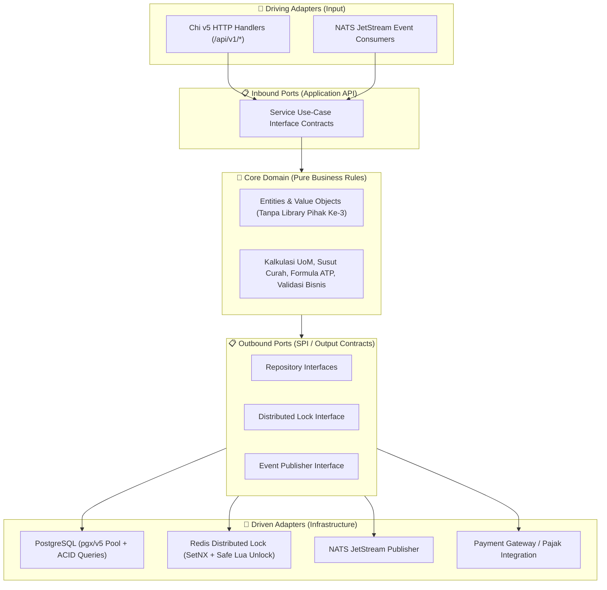

# BangunGrid 🏗️

> **Enterprise-Grade Building Materials E-Commerce & Supply Chain Ecosystem**  
> Platform terintegrasi untuk distribusi dan penjualan bahan bangunan modern: menghubungkan pabrikan/principal, distributor, kontraktor B2B, dan pembeli ritel B2C dengan logistik berat (*heavy logistics*), manajemen multi-satuan (UoM), serta penanganan material curah.

---

## 🏛️ Arsitektur Global Sistem (System Architecture)

Arsitektur sistem dirancang dengan pendekatan **Cloud-Native Microservices**, mengadopsi **Hexagonal Architecture (Ports and Adapters)** pada setiap service Go, **KrakenD API Gateway** sebagai gerbang tunggal (*Single Entry Point* dengan jalur migrasi terencana ke **Kong**), serta **NATS & NATS JetStream** untuk orkestrasi asinkron berbasis peristiwa (*Event-Driven Architecture*).

```mermaid
graph TB
    subgraph ClientTier ["📱 Lapisan Klien / Client Presentation Tier"]
        ReactPWA["🌐 React PWA (Next.js SSR + CSR)<br>• Katalog Publik SEO-Friendly<br>• Portal B2B Tender & RFQ Kontraktor<br>• Backoffice Admin & Finance"]
        FlutterCust["📱 Flutter Mobile (Customer & Contractor)<br>• Katalog Ritel & Checkout B2C<br>• Kalkulator Material & BoQ Proyek<br>• Live Tracking Armada Kirim"]
        FlutterDriver["🚛 Flutter Mobile (Driver & Logistik)<br>• Surat Jalan Digital (e-DO)<br>• Offline-First e-POD (Foto + Tanda Tangan)"]
        FlutterPOS["📟 Flutter Tablet (POS Toko Cabang)<br>• Kasir Kasir Cepat & Offline-Capable<br>• Integrasi Printer Bluetooth Thermal"]
    end

    subgraph GatewayTier ["🚪 API Gateway Tier (Single Entry Point)"]
        KrakenD["⚡ KrakenD API Gateway (Go-Native, Stateless)<br>• Validasi JWT RSA-256 Terpusat<br>• Injeksi Header Standar (X-User-ID, X-Tenant-ID, X-Roles)<br>• Proteksi Anti-Scraping & Rate Limiting per IP/Tenant<br>• CORS & SSL Termination Terpadu<br>• [Jalur Migrasi Siap ke Kong Gateway di Fase Enterprise]"]
    end

    subgraph MicroservicesTier ["⚙️ Go Microservices Tier (Hexagonal Architecture + Chi Router)"]
        AuthSvc["🔐 auth-service (:8085)<br>• Identitas & Multi-Tenant<br>• JWT RSA-256 & JWKS Public Keys<br>• Role: B2B, B2C, Driver, Kasir, Admin"]
        CatalogSvc["📦 catalog-service (:8086)<br>• Piramida Multi-UoM (Sak/Palet/Ton)<br>• Matriks Densitas Material Curah (m³ ↔ Kg)<br>• Validasi Toleransi Timbangan Jembatan"]
        InventorySvc["🏭 inventory-service (:8087)<br>• Multi-Gudang, Stockyard & Silo<br>• Available-to-Promise (ATP)<br>• Distributed Lock (Redis) & Soft-Reservation<br>• Audit Susut Curah (Shrinkage Ledger)"]
        OrderSvc["🛒 order-service (:8088)<br>• Checkout Ritel B2C & Biaya Kuli Bongkar<br>• RFQ Tender Kontraktor & Plafon Kredit<br>• Pengiriman Parsial (Call-Off Orders)"]
        FleetSvc["🚚 fleet-service (:8089)<br>• Optimasi Muatan Truk (Tonase vs Kubikasi)<br>• Zonasi Pengiriman & Pelacakan Rute GPS<br>• Verifikasi Digital e-POD"]
        BillingSvc["💳 billing-service (:8090)<br>• Rekonsiliasi Payment Gateway (QRIS/VA)<br>• Plafon Kredit B2B (TOP 30-90 Hari)<br>• Integrasi e-Faktur Pajak PPN (11%)"]
        NotifSvc["🔔 notification-service<br>• Push Notifikasi FCM & Webhook<br>• WhatsApp Dispatcher & Email Pengingat"]
    end

    subgraph DataEventTier ["💾 Lapisan Data, Caching & Event Streaming"]
        Postgres[(🐘 PostgreSQL 16 + PostGIS Spasial<br>Database-per-Service Terisolasi:<br>• db_auth • db_catalog • db_inventory<br>• db_order • db_fleet (PostGIS) • db_billing)]
        RedisCluster[(⚡ Redis 7 In-Memory<br>• Distributed Stock Locking (SetNX + Lua)<br>• Idempotency Keys Middleware<br>• Fast ATP Caching)]
        NatsJetStream[(📨 NATS 2.10 & JetStream<br>• NATS Core: Pub/Sub & Telemetri Realtime<br>• JetStream: Saga Pattern & Log Peristiwa Persisten)]
        MinIOS3[(🪣 MinIO S3 Object Storage<br>• Arsip Foto e-POD & Surat Jalan<br>• Dokumen Faktur Pajak & Berita Acara)]
    end

    %% Relasi Klien ke Gateway
    ReactPWA -->|HTTPS / REST API| KrakenD
    FlutterCust -->|HTTPS / REST API| KrakenD
    FlutterDriver -->|HTTPS / REST API| KrakenD
    FlutterPOS -->|HTTPS / REST API| KrakenD

    %% Relasi Gateway ke Microservices
    KrakenD -->|Reverse Proxy / HTTP Private| AuthSvc
    KrakenD -->|Reverse Proxy / HTTP Private| CatalogSvc
    KrakenD -->|Reverse Proxy / HTTP Private| InventorySvc
    KrakenD -->|Reverse Proxy / HTTP Private| OrderSvc
    KrakenD -->|Reverse Proxy / HTTP Private| FleetSvc
    KrakenD -->|Reverse Proxy / HTTP Private| BillingSvc

    %% Relasi Microservices ke Data & Event
    AuthSvc --> Postgres
    AuthSvc --> RedisCluster
    AuthSvc --> NatsJetStream

    CatalogSvc --> Postgres
    CatalogSvc --> RedisCluster

    InventorySvc --> Postgres
    InventorySvc --> RedisCluster
    InventorySvc --> NatsJetStream

    OrderSvc --> Postgres
    OrderSvc --> RedisCluster
    OrderSvc --> NatsJetStream

    FleetSvc --> Postgres
    FleetSvc --> NatsJetStream
    FleetSvc --> MinIOS3

    BillingSvc --> Postgres
    BillingSvc --> NatsJetStream
    BillingSvc --> MinIOS3

    NotifSvc --> NatsJetStream
```

---

## 🧩 Arsitektur Internal Tiap Layanan (Hexagonal / Clean Architecture)

Setiap microservice ditulis menggunakan bahasa **Go (Golang)** yang memisahkan aturan bisnis dari dependensi infrastruktur eksternal:



---

## 📦 Status Implementasi Microservices

| Service | Port Host | Port Kontainer | Status | Cakupan Fitur Utama |
| :--- | :--- | :--- | :--- | :--- |
| **`auth-service`** | `8085` | `8081` |  **Selesai** | Multi-Tenant, RSA-256 JWT & JWKS, User Roles (B2B, B2C, Driver, Kasir, Admin), Idempotency. |
| **`catalog-service`** | `8086` | `8082` |  **Selesai** | Multi-UoM (Sak/Palet/Ton), Matriks Massa Jenis Curah ($m^3 \leftrightarrow \text{Kg}$), Verifikasi Toleransi Jembatan Timbang. |
| **`inventory-service`** | `8087` | `8083` |  **Selesai** | Multi-Gudang/Stockyard/Silo, Available-to-Promise (ATP), Distributed Locking (Redis), Reservasi Stok, Susut Curah (*Shrinkage*). |
| **`order-service`** | `8088` | `8084` |  *Berikutnya* | Checkout Omnichannel B2C, RFQ Kontraktor B2B, Partial Delivery Call-Off, Manajemen Termin. |
| **`fleet-service`** | `8089` | `8085` |  *Terencana* | Kalkulasi Kubikasi vs Tonase Armada, Dispatching Surat Jalan, Tracking GPS & Offline e-POD. |
| **`billing-service`** | `8090` | `8086` |  *Terencana* | Rekonsiliasi Otomatis, Limit Plafon Kredit B2B, e-Faktur Pajak PPN (11%), Aging AR Warning. |
| **`notification-service`**| - | - |  *Terencana* | Dispatcher WhatsApp, Push Notification FCM, Email Faktur. |

---

## 🚀 Panduan Memulai Cepat (Quick Start)

### 1. Prasyarat Sistem
* **Docker & Docker Compose** (v24+)
* **Go (Golang)** 1.21+
* **GNU Make**

### 2. Menjalankan Seluruh Ekosistem Kontainer
Nyalakan backing services (PostgreSQL PostGIS, Redis, NATS, MinIO) beserta microservice:

```bash
# Menyalakan seluruh ekosistem (Background daemon)
make docker-up

# Memeriksa status kesehatan kontainer
docker compose ps
```

### 3. Pengecekan Kualitas Kode & Pengujian Otomatis

```bash
# Menjalankan seluruh Unit Test dengan Data Race Detector (-race):
make test-race

# Menjalankan Automated End-to-End Integration Tests:
make test-integration

# Verifikasi menyeluruh (Linting, Security Scanner, Dependency Vulnerability, Tests):
make verify-all
```

---

## 🔒 Standar Keamanan & Performa Enterprise
1. **Keamanan Tanpa Root**: Seluruh Docker image dibangun dengan *multi-stage build* dan dijalankan menggunakan non-root user (`appuser:10001`).
2. **Database-per-Service**: Isolasi mutlak antar basis data microservice guna mencegah *coupling* dan memudahkan penskalaan independen.
3. **Idempotensi & Transaksi Terdistribusi**: Middleware Idempotency berbasis Redis dan Saga Pattern via NATS JetStream menjamin integritas transaksi pemesanan bernilai besar.
4. **DevSecOps Terpasang**: Integrasi `golangci-lint`, `gosec` (Security Static Analysis), dan `govulncheck` (Audit Kerentanan Dependensi) di level Make target.

---

## 📄 Lisensi
Hak Cipta © 2023 BangunGrid. Seluruh hak cipta dilindungi undang-undang.
